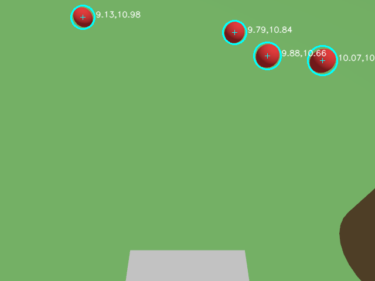

# ApplePic

A simulated robot that finds apples on the ground of an orchard, collects them and brings them back to a depot.
Built with ROS 2 Jazzy and Gazebo Harmonic, developed mostly by autonomous [Claude Code](https://claude.com/claude-code) sessions.

| Mission trajectory | What the camera sees |
|---|---|
|  |  |

## Status
**Working today, measured headless:**
- The robot goes around each of the 6 trees, searches the ground with its camera, picks the apples and empties its basket at the depot.
- Default orchard: 29/29 apples deposited in about 720 simulated seconds (about 4.5 min of real time at 3x speed).
- Coarse GPS (0.5 m noise + 1 m bias) with the pose corrected on tree trunks: 31/31 on one orchard. With unknown obstacles added: 26/29 on the latest run.

**Not there yet:**
- **The robot has no arm yet.** Picking is "magic": an apple within 7 cm of a virtual gripper point is removed from the simulation. A real arm and two-finger gripper with MoveIt 2 are the next milestones.
- The wheels pass through apples, a simplification made to stop the physics engine from throwing them.
- The world is easy: flat ground and plain colours, with no red objects to confuse the color-based detector.
- Results vary between runs. The GUI demo was last run in session 14, before the latest changes.

The plan, with a verifiable criterion per milestone, is in [`KICKOFF.md`](KICKOFF.md). See also the [audit](docs/AUDIT.md) and the [design decisions](docs/DECISIONS.md).

## How it works
| Part | Approach |
|---|---|
| Perception | HSV color segmentation, pixels projected on the flat ground |
| Search | Camera coverage grid around each tree, tree left once its ground has been seen |
| Mission | Pure Python state machine, unit tested without ROS |
| Localization | Ground truth, or a home-made EKF on GPS, wheel odometry, gyro and tree trunks seen by the camera |
| Obstacles | Remembered on bumper contact, then avoided with a grid search |

## Requirements
- Ubuntu 24.04 with ROS 2 Jazzy and `ros-jazzy-ros-gz`.
- A GPU is recommended for camera rendering. Only tested on an NVIDIA GPU.

## Quick start
```bash
make test   # build and unit tests (~20 s)
make e2e    # full mission headless (~5 min), prints PASS or FAIL
make demo   # full mission with the Gazebo and RViz windows
```
`make e2e` writes `artifacts/e2e_metrics.json` and `artifacts/e2e_trajectory.png`.

Variations:
```bash
make e2e E2E_SEED=7                                  # other apple positions
make e2e LOCALIZATION=gps GPS_NOISE=0.5 GPS_BIAS=1.0 # coarse GPS
make e2e ORCHARD_CONFIG=src/applepic_gazebo/config/orchard_hard.yaml      # tall grass, damaged apples
make e2e ORCHARD_CONFIG=src/applepic_gazebo/config/orchard_obstacles.yaml # unknown obstacles
```

## Demo
`make demo` opens Gazebo and RViz (about 15 s to appear, needs a screen). A full loop takes about 12 minutes at real-time speed; `make demo DEMO_RTF=2` runs it at twice the speed if the machine keeps up. `Ctrl+C` stops everything.

If the robot has not moved after 30 s, stop and start again: one start in 9 stayed silent in earlier testing, cause unknown.

To follow the mission in another terminal:
```bash
source /opt/ros/jazzy/setup.bash && source install/setup.bash
ros2 topic echo /mission/status
ros2 topic echo /basket/count
```

## Repository layout
| Package | Content |
|---|---|
| `applepic_description` | Robot URDF |
| `applepic_gazebo` | Orchard world generator, worlds, bridge configuration |
| `applepic_navigation` | Controller, path planning, GPS model, localization |
| `applepic_perception` | Apple and trunk detection, projection on the ground |
| `applepic_mission` | State machine, apple tracker, coverage, magic gripper, RViz markers |
| `applepic_bringup` | Launch files |

## License
[Apache-2.0](LICENSE)
