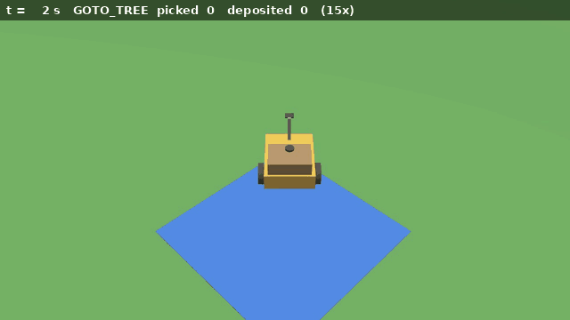
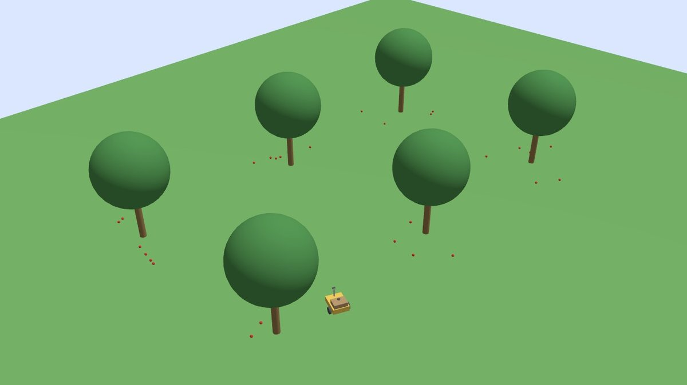
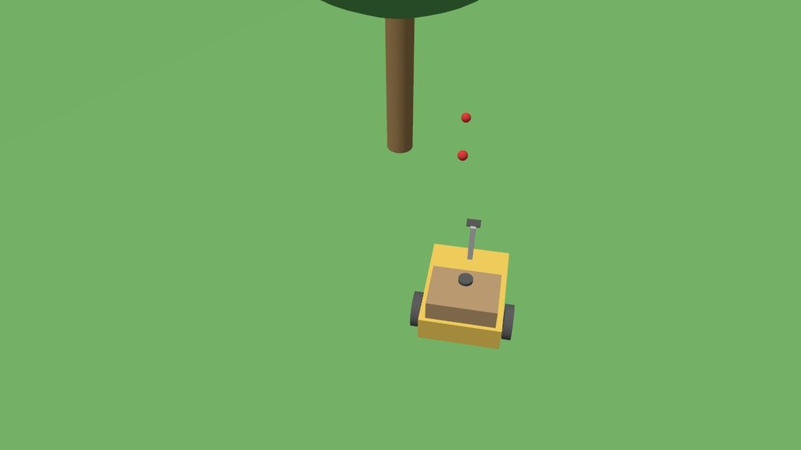
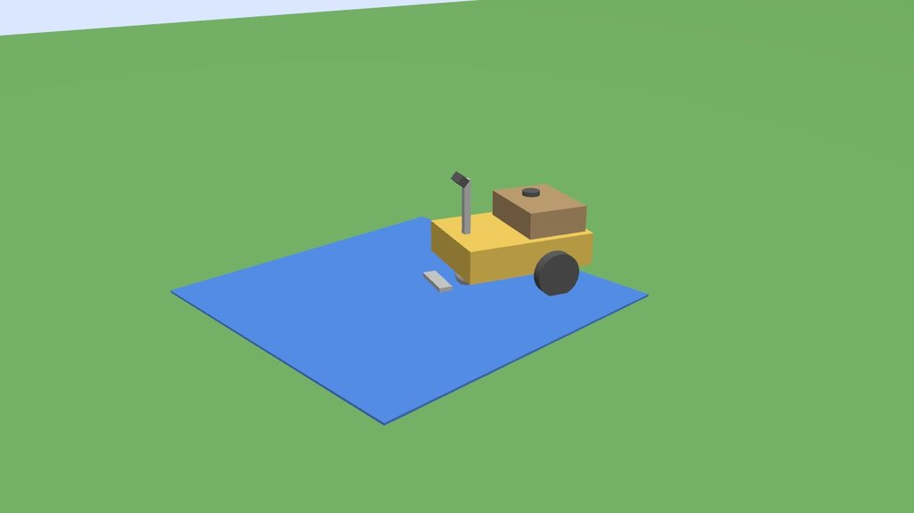
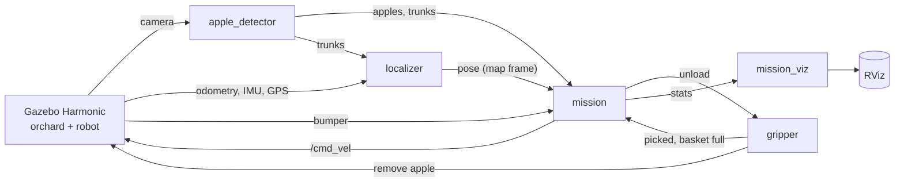
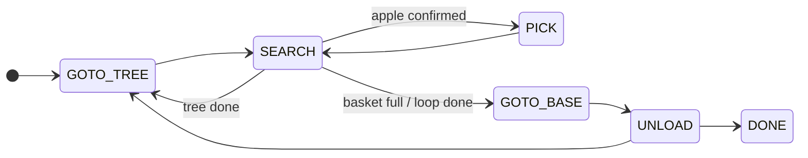
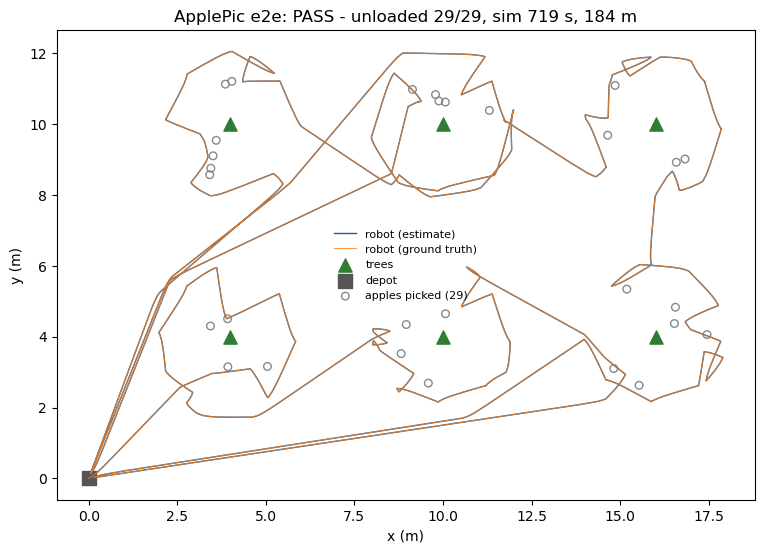
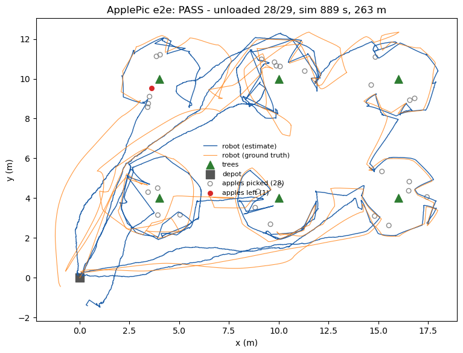

# ApplePic

**A simulated robot that finds apples fallen in an orchard, picks them up and brings them back to a depot.**

[](https://github.com/marcocopops/applepic/actions/workflows/ci.yml)
[](LICENSE)
[](https://docs.ros.org/en/jazzy/)
[](https://gazebosim.org/docs/harmonic/)



## What it does

Apples that fall on the ground are lost if nobody picks them up in time. ApplePic is a proof of concept, in
simulation, of a small autonomous robot (a 60 x 45 cm mower-style base with a camera and a basket) that
does this job:

1. **Go to the next tree**: one waypoint per tree, with a path around trunks and known obstacles.
2. **Search the ground around it**: the robot circles the tree and keeps a grid of the ground its camera has seen.
3. **Detect** apples in the camera image and locate them on the ground.
4. **Pick** each apple (simulated for now: see [status](#project-status-and-roadmap)).
5. **Next tree**, once the whole ring under the tree has been seen.
6. **Unload** at the depot when the basket is full or the loop is done, then **repeat**.

## Key features

| | |
|---|---|
|  |  |
|  |  |

- **Perception**: HSV color segmentation, pixels projected on the flat ground (error at most 1.5 cm), and detection fusion into tracks.
- **Coverage-driven search**: the camera footprint is projected on a 10 cm grid around each tree; the robot leaves once 99.5 % of the ground where apples fall has been seen.
- **Pure-Python mission state machine**, unit tested without ROS.
- **GPS localization**: a home-made EKF on GPS, wheel odometry and gyro, corrected on tree trunks seen by the camera. It still works with a coarse GPS (0.5 m noise + 1 m bias).
- **Bumper**: contacts with unknown obstacles are remembered, and the next path goes around them (A* on a grid).
- **Configurable orchards** generated from YAML: default, hard (tall grass, orange, dark and bruised apples), and with unknown obstacles.
- **Headless end-to-end test** scored against Gazebo: picked apples must really be gone from the world.

## Architecture





| Package | Role |
|---|---|
| `applepic_description` | Robot URDF: differential base, camera, IMU, GPS, bumper, basket |
| `applepic_gazebo` | Orchard world generator (YAML → SDF + ground-truth apple manifest), ros_gz bridge |
| `applepic_perception` | Apple and trunk detection, projection on the ground |
| `applepic_navigation` | Point controller, A* path planning, GPS model, EKF localization |
| `applepic_mission` | Mission state machine, apple tracker, coverage grid, gripper, RViz markers |
| `applepic_bringup` | Launch files |

More in [`docs/architecture.md`](docs/architecture.md) and the design decisions in [`docs/decisions.md`](docs/decisions.md).

## Quick start

Prerequisites: Ubuntu 24.04, [ROS 2 Jazzy](https://docs.ros.org/en/jazzy/Installation.html) and Gazebo Harmonic
through `ros-jazzy-ros-gz`. A GPU is recommended for camera rendering (tested on NVIDIA only).

```bash
sudo apt install ros-jazzy-ros-gz ros-jazzy-xacro ros-jazzy-cv-bridge python3-opencv
git clone https://github.com/marcocopops/applepic.git && cd applepic

make test   # build + unit tests (~20 s)
make e2e    # full mission headless at 3x real time (~5 min), prints PASS or FAIL
make demo   # full mission with the Gazebo and RViz windows (needs a screen)
```

`make e2e` writes `artifacts/e2e_metrics.json` and a trajectory plot `artifacts/e2e_trajectory.png`. Variants:

```bash
make e2e E2E_SEED=7                                  # other apple positions
make e2e LOCALIZATION=gps GPS_NOISE=0.5 GPS_BIAS=1.0 # coarse GPS
make e2e ORCHARD_CONFIG=src/applepic_gazebo/config/orchard_hard.yaml       # tall grass, damaged apples
make e2e ORCHARD_CONFIG=src/applepic_gazebo/config/orchard_obstacles.yaml  # unknown obstacles
```

An optional `docker/Dockerfile` (`make docker-image`, then `USE_DOCKER=1 make test`) exists but has not been verified; the native
setup is the tested one. CI runs the build and unit tests in the official `ros:jazzy-ros-base` image.

## Results

Headless runs of `make e2e` (one loop from the depot, 6 trees, capacity 10 apples, 3x real time), measured on
2026-11-12 on an NVIDIA laptop GPU. Time is simulated time; runs are not deterministic.

| Scenario | Apples deposited | Time | Distance | Wall time |
|---|---|---|---|---|
| Default orchard, run 1 | **29 / 29** | 719 s | 184 m | 4 min 18 s |
| Default orchard, run 2 | **29 / 29** | 725 s | 184 m | 4 min 18 s |
| Hard orchard (tall grass, orange, dark and bruised apples) | **29 / 29** | 739 s | 187 m | 4 min 34 s |
| Coarse GPS (0.5 m noise + 1 m bias), default orchard | **28 / 29** | 889 s | 263 m | 5 min 16 s |

With the coarse GPS the localization error against ground truth was 0.65 m on average (95th percentile 1.66 m),
and 3 pick attempts were given up.

| Default orchard: 29/29 | Coarse GPS: estimated (blue) vs true (orange) path |
|---|---|
|  |  |

## Project status and roadmap

**What is simulated or simplified today**
- **There is no arm yet.** Picking is "magic": when the gripper point is within 7 cm of an apple, using the
  ground-truth pose, the apple is removed from the simulation.
- The wheels do not collide with apples, so the robot never pushes or crushes them.
- The world is easy: flat ground, plain colors, fixed lighting, tree positions known in advance.
- Navigation uses a home-made controller, EKF and A* rather than Nav2.

**Next** (each step has a criterion checked headless, see [`docs/roadmap.md`](docs/roadmap.md))
1. Clean-up and validation series (several runs per scenario, median score).
2. A **real articulated arm with a two-finger gripper, driven by MoveIt 2**. An apple is attached only when both fingers touch it, and picking uses the camera estimate instead of the ground truth.
3. Demo video, then perception measured on scenes with traps (red objects, leaves, three lightings).
4. Validation of the simulated proof of concept: 3 orchards x 3 runs, at least 90 % of apples deposited.
5. A **physical prototype**, targeted for summer 2027.

## How it was built

Most of this code was written by [Claude Code](https://claude.com/claude-code) running unattended, in a loop:
each session starts with an empty context, reads the brief and the progress notes in the repository, implements
the next milestone, checks it headless, commits and hands over. A human sets the goals and reviews between
runs. The brief, the runner script, an audit of what worked and what did not, and the lessons learned are in
[`docs/ai-workflow/`](docs/ai-workflow/).

## License

[Apache-2.0](LICENSE) © Marc-Antoine Meunier
