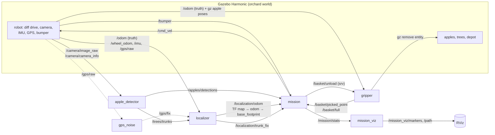
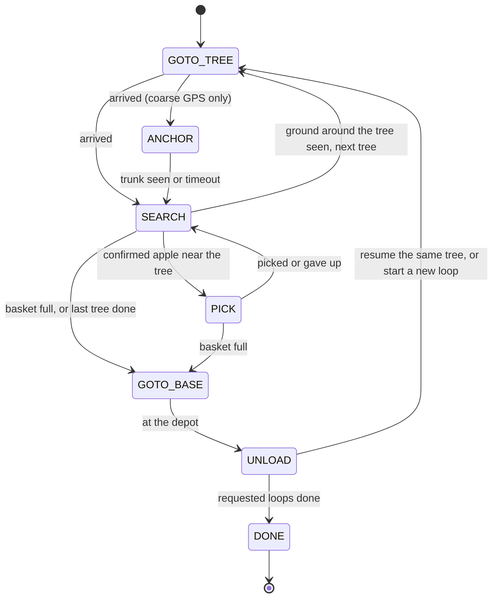

# Architecture

ApplePic is a ROS 2 Jazzy workspace of six `ament_python` packages driving a robot in Gazebo Harmonic.
Every node is a thin ROS adapter around a pure Python module (no `rclpy`) that pytest tests without a
running simulation. The reasons behind each choice are in [`decisions.md`](decisions.md) (D1 to D21).

## Nodes and topics

| Node | Package | Role |
|---|---|---|
| `apple_detector` | `applepic_perception` | HSV segmentation of red/orange apples and brown trunk feet, pixels projected on the flat ground. Publishes apple positions and trunk positions. |
| `localizer` | `applepic_navigation` | One pose contract for every node: `/localization/odom` + TF. `truth` mode republishes the ground truth; `gps` mode runs a 3-state EKF on `map → odom` fed by GPS, wheel odometry, gyro and trunks seen by the camera. |
| `gps_noise` | `applepic_navigation` | Adds seeded white noise and a wandering bias to the perfect gz GPS fix (`gps` mode only). |
| `mission` | `applepic_mission` | Adapter around the `Mission` state machine: fuses detections into tracks, plans paths, sends `/cmd_vel`, calls the unload service. |
| `gripper` | `applepic_mission` | **Simulated "magic" picking**: an apple within 7 cm of the gripper point is removed from gz and counted in the basket. Uses ground truth; replaced by a real arm at M20. |
| `mission_viz` | `applepic_mission` | RViz markers for the demo: trees, search circles, depot, robot path, mission state and basket count. |

Supporting pure modules: `detector.py`, `trunk.py`, `projection.py` (perception); `controller.py`, `route.py`
(A* around remembered bump points), `localization.py`, `gps.py` (navigation); `mission.py`,
`apple_tracker.py`, `coverage.py`, `approach.py`, `basket.py`, `metrics.py`, `viz.py` (mission);
`orchard.py` (world generator).

## Mission state machine

- **GOTO_TREE**: path to the closest point of the search circle (1.9 m around the trunk), going around trunks and
  remembered obstacles.
- **SEARCH**: views around the trunk, chosen by a camera-coverage grid of the 0.4 to 1.7 m ring where apples
  fall. The tree is left once 99.5 % of the ring has been seen and no apple track remains.
- **PICK**: drive the gripper point onto the apple, using the fused track when the apple leaves the camera view.
- **ANCHOR**: with a coarse GPS only, creep towards the trunk until the camera sees its foot, to correct the pose.
- A full basket sends the robot to the depot from any working state, then back to the same tree.
- A bumper contact makes the robot back off and remember the contact points as obstacles.

## Simulation

- The orchard is generated from YAML (`applepic_gazebo/config/*.yaml`) into an SDF world and an apple manifest
  used as ground truth for scoring. Variants: default, hard (tall grass, orange, dark and bruised apples),
  obstacles unknown to the robot.
- The robot (`applepic_description/urdf/applepic.urdf.xacro`): 60 x 45 cm differential base, 10 cm ground
  clearance, front caster, camera at 0.5 m tilted down, IMU, GPS, contact bumper, visual basket.
- Wheels and caster do not collide with apples (D19): the robot drives over them without throwing them.
- `scripts/e2e_mission.sh` runs the full mission headless at 3x real time and scores it against Gazebo: picked
  apples must really be gone from the world, and the deposited count must match.

## Known simplifications
- Picking is magic: no arm, no grasp physics, and the gripper uses the ground-truth pose (D7).
- Flat ground, plain colours, fixed lighting, tree positions known in advance.
- Navigation is a home-made controller, EKF and A*, because Nav2 and `robot_localization` were not installed.
